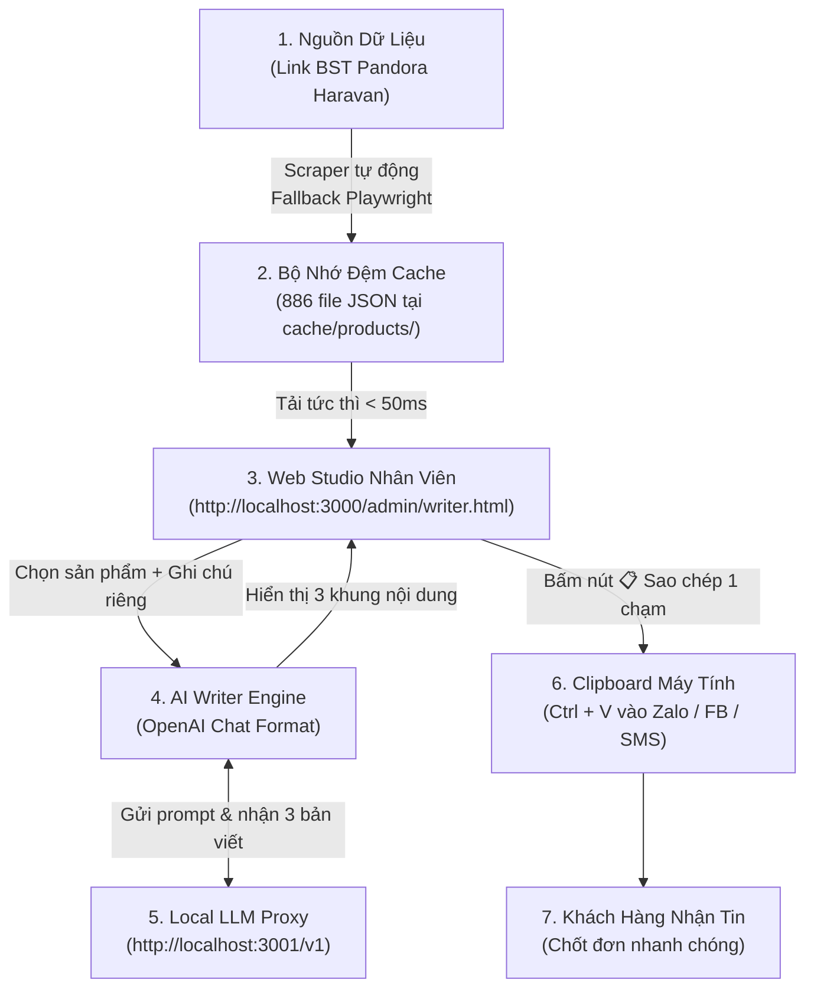

# 📖 HƯỚNG DẪN VẬN HÀNH: PANDORA SALES CONTENT STUDIO

Tài liệu mô tả chi tiết **luồng hoạt động toàn diện (End-to-End Flow)** và **hướng dẫn khởi động hệ thống** tạo bài viết sản phẩm tự động để nhân viên sales copy-paste gửi khách hàng qua Zalo/Facebook.

---

## 🧭 1. LUỒNG HOẠT ĐỘNG (END-TO-END FLOW)

Sơ đồ quy trình từ dữ liệu website đến tay khách hàng:



### Chi tiết 4 chặng vận hành:

1. **Chặng 1 — Quét & Chuẩn hóa dữ liệu (Scraper & Normalizer)**:
   - Hệ thống tự động phân tích URL chiến dịch (ví dụ link `.../collections/fday?...`).
   - Gọi trực tiếp Haravan JSON API với gói `limit=250` sản phẩm/trang.
   - Nếu bị chặn IP hay mạng chập chờn, tự động bật **Playwright Chromium headless** để vượt rào.
   - Dữ liệu thô được bóc tách HTML, tính giá thấp nhất, giá so sánh, % giảm giá, định dạng tiền tệ VNĐ và bóc tách biến thể (size, chất liệu bạc/vàng).

2. **Chặng 2 — Lưu trữ & Quản lý bộ nhớ đệm (Cache Layer)**:
   - Mỗi sản phẩm được mã hóa hash MD5 và lưu thành file `.json` riêng trong thư mục `cache/products/`.
   - Cơ chế kiểm tra đối chiếu (partition): chỉ cào sản phẩm mới phát sinh, sản phẩm đã có trong bộ nhớ được đọc trực tiếp từ đĩa cứng với tốc độ tức thì.
   - Định kỳ cập nhật lại trạng thái tồn kho thời gian thực.

3. **Chặng 3 — Trợ lý AI sáng tạo nội dung (AI Writer Engine)**:
   - Kết nối tới cổng Localhost Proxy tại `http://localhost:3001/v1`.
   - Tự động nạp thông tin sản phẩm và phân tích tâm lý khách hàng ngành trang sức cao cấp.
   - Sinh đồng thời **3 mẫu nội dung chuyên biệt**:
     - 💬 **Tin nhắn Zalo 1-1**: Văn phong thân mật (Em/Anh/Chị), tạo cảm giác tư vấn riêng, thông báo quà tặng và gợi mở câu hỏi kết bài.
     - 📱 **Caption Social / Zalo Story**: Giật tít hook, emoji bắt mắt, gạch đầu dòng tính năng/quà tặng, danh sách hashtag chuẩn SEO.
     - ⚡ **Chào hàng siêu ngắn**: 2-3 câu ngắn gọn, súc tích kèm link mua hàng, thích hợp gửi kèm ảnh sản phẩm.

4. **Chặng 4 — Trải nghiệm nhân viên bán hàng (1-Click Copy-Paste)**:
   - Nhân viên tìm kiếm tên sản phẩm trên giao diện trực quan.
   - Tùy ý nhập thêm tên khách hàng hoặc lưu ý riêng (ví dụ: *khách quen mua quà 20/10, ưu đãi tặng thêm ô dù...*).
   - Đọc trước và sửa chữ trực tiếp trong ô nếu muốn.
   - Bấm nút **"📋 Copy"** $\rightarrow$ Hệ thống tự động lưu vào bộ nhớ tạm của máy tính, nhân viên chỉ việc mở Zalo và dán (`Ctrl + V`) gửi khách.

---

## 🚀 2. HƯỚNG DẪN KHỞI ĐỘNG HỆ THỐNG

### Bước 1: Khởi động Local LLM Proxy (Cổng xoay Model)
Đảm bảo cổng proxy xoay model của bạn đang chạy ở địa chỉ:
```
http://localhost:3001/v1
```

---

### Bước 2: Khởi động Web Server
Mở terminal (PowerShell hoặc Command Prompt) tại thư mục dự án và chạy lệnh:

```powershell
npm start
```

Khi màn hình hiển thị:
```
Server running at http://localhost:3000
```
là máy chủ đã sẵn sàng hoạt động!

*(Nếu muốn chế độ tự động reload khi sửa code, dùng lệnh: `npm run dev`)*

---

### Bước 3: Truy cập Web Studio
Mở trình duyệt bất kỳ (Chrome, Edge, Cốc Cốc, Brave...) và truy cập vào đường dẫn:

👉 **`http://localhost:3000/admin/writer.html`**

---

### Bước 4: Thiết lập API Key cho Proxy (Chỉ làm 1 lần đầu tiên)
1. Trên thanh tiêu đề góc trên bên phải, bấm vào nút **⚙️ Cài đặt (Localhost:3001)**.
2. Một bảng cài đặt sẽ hiện ra:
   - **Proxy URL**: Giữ nguyên `http://localhost:3001/v1`.
   - **API Key**: Điền mã API Key tương ứng với proxy localhost của bạn.
   - **Tên Model**: Điền model bạn muốn dùng (hoặc để `default` để proxy tự xoay).
3. Bấm **"Kiểm tra kết nối"** $\rightarrow$ Khi hiện dòng chữ màu xanh lá `✅ Kết nối thành công` $\rightarrow$ Bấm **"Lưu cài đặt"**.
*(Thông tin này sẽ được lưu trên trình duyệt của bạn, lần sau mở lên không cần nhập lại).*

---

## 🖱️ 3. HƯỚNG DẪN SỬ DỤNG CHO NHÂN VIÊN SALES

1. **Lọc theo Mảng Sản Phẩm (Category Pills)**:
   - Trên cột bên trái, bấm vào các tab danh mục: **🌟 Tất cả**, **⭕ Vòng tay**, **🔮 Charm & Hạt**, **📿 Dây chuyền**, **💍 Nhẫn**, **💎 Hoa tai**, **🎁 Combo / Quà**.
   - Mỗi tab đều có huy hiệu số lượng đếm tự động (VD: Charm & Hạt (320), Vòng tay (142)...).
   - Có thể kết hợp lọc nhanh theo Bộ sưu tập (BST): **Moments**, **Pandora ME**, **Timeless**.

2. **Tìm kiếm tức thì (Không dấu & Có dấu)**:
   - Gõ bất kỳ từ khóa nào: *vong tay*, *khoa tim*, *bac 925*, *hoa tai*, *nhan*...
   - Hệ thống tự động chuẩn hóa tiếng Việt không dấu và lọc ngay lập tức sau từng phím gõ (< 5ms).
   - Có nút **✕** để xóa nhanh từ khóa tìm kiếm.

3. **Cá nhân hóa tin nhắn (Tùy chọn)**:
   - Nhập tên khách (VD: *Chị Hạnh*, *Anh Nam*).
   - Nhập ghi chú nếu có (VD: *Tặng thêm bình giữ nhiệt cho đơn trên 6 triệu*).

4. **Sinh bài viết**:
   - Bấm nút hồng **✨ Tạo 3 Mẫu Bài Viết**.
   - Chờ khoảng 1-3 giây để AI viết bài.
4. **Copy & Gửi khách**:
   - Kiểm tra 3 ô nội dung: Zalo 1-1, Caption Social, hoặc Tin nhắn ngắn.
   - Bạn có thể gõ sửa đổi trực tiếp vào ô văn bản.
   - Bấm nút **📋 Copy** tương ứng $\rightarrow$ Nút chuyển sang xanh lá **✅ Đã chép!**.
   - Mở app Zalo / Facebook $\rightarrow$ Bấm `Ctrl + V` để gửi cho khách hàng!

---

## 🛠️ 4. KIỂM THỬ & SỬA LỖI (TROUBLESHOOTING)

| Hiện tượng | Nguyên nhân | Cách xử lý |
| :--- | :--- | :--- |
| **Nút proxy báo màu đỏ / "Proxy cần API Key"** | Proxy `localhost:3001` yêu cầu xác thực mà bạn chưa nhập key | Bấm vào nút cài đặt góc trên, nhập API Key của proxy rồi bấm lưu |
| **Không tải được danh sách sản phẩm** | Chưa chạy `npm start` hoặc cache bị lỗi | Chạy lệnh `npm test` trong terminal để kiểm tra tính toàn vẹn |
| **Muốn cào lại sản phẩm mới nhất** | Website Pandora cập nhật thêm mẫu mới | Gọi API: `http://localhost:3000/api/writer/products?collection=fday&refresh=true` |
| **Lỗi "Mất kết nối Proxy"** | Ứng dụng proxy tại cổng 3001 chưa được bật | Khởi động lại phần mềm proxy cổng 3001 |

---

*Hệ thống được thiết kế độc lập, bảo mật nội bộ và lưu cache cục bộ trên máy tính của bạn.*
