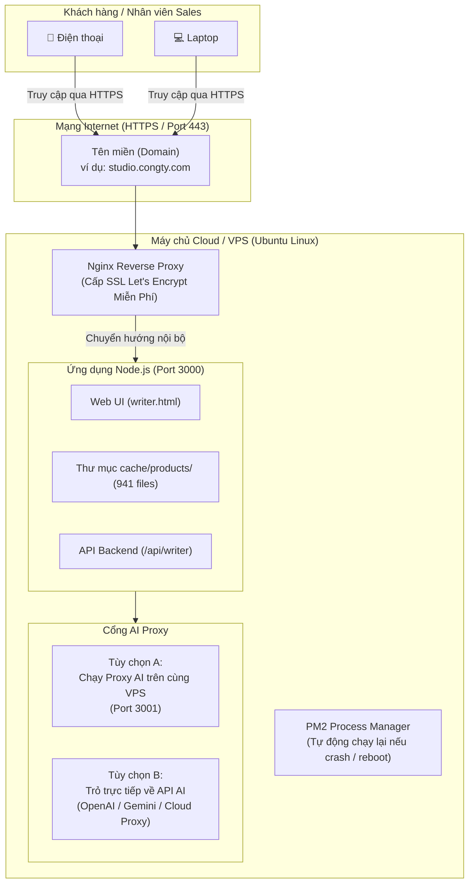

# 🌐 MASTER PLAN: ĐƯA PANDORA CONTENT STUDIO LÊN SERVER (HOSTING & DEPLOYMENT)

Tài liệu này giải thích chi tiết kiến trúc, các thách thức cần xử lý khi đưa ứng dụng từ máy tính cá nhân (localhost) lên môi trường máy chủ Internet (Production Server), kèm **Plan triển khai từng bước (Step-by-step Execution Plan)**.

---

## 🧭 1. GIẢI THÍCH KIẾN TRÚC KHI ĐƯA LÊN SERVER

Hiện tại ứng dụng của bạn đang chạy ở máy cá nhân gồm 2 thành phần:
1. **Web App (Node.js/Express)**: Chạy ở cổng `3000` (phục vụ giao diện Studio, cào sản phẩm Pandora, quản lý cache).
2. **Local LLM Proxy**: Chạy ở cổng `3001` (xoay model, gọi AI).

Khi đưa lên máy chủ Internet (Server/VPS), kiến trúc chuẩn sẽ như sau:



---

## ⚖️ 2. CHỌN HẠ TẦNG (SERVER SELECTION)

| Tiêu chí | Phương án 1: VPS Linux (Khuyên dùng) | Phương án 2: Cloud PaaS (Render / Railway) |
| :--- | :--- | :--- |
| **Bản chất** | Thuê máy chủ ảo riêng (Ubuntu 22.04 / 24.04) | Thuê nền tảng ứng dụng đóng gói sẵn |
| **Chi phí** | Rẻ (~100.000đ – 150.000đ/tháng tại Vietnix, TinoHost, DigitalOcean, Hetzner) | Miễn phí hoặc ~150.000đ – 300.000đ/tháng |
| **Ưu điểm** | - Lưu trữ vĩnh viễn 941 file cache trên ổ đĩa SSD.<br>- Chạy được cả Proxy AI (cổng 3001) trên cùng 1 máy.<br>- Toàn quyền kiểm soát và bảo mật nội bộ. | - Dễ triển khai chỉ với 1 click từ GitHub. |
| **Nhược điểm** | Cần cấu hình dòng lệnh Linux cơ bản (có hướng dẫn bên dưới). | File cache dễ bị xóa khi server sleep hoặc restart (Ephemeral filesystem). |

👉 **Khuyên dùng**: **Phương án 1 (VPS Ubuntu)** vì ứng dụng có thư mục `cache/products/` và proxy `localhost:3001`.

---

## 📋 3. MASTER PLAN TRIỂN KHAI (5 BƯỚC END-TO-END)

### BƯỚC 1: Chuẩn bị VPS & Môi trường Linux
1. Thuê VPS: Cấu hình tối thiểu: **1 vCPU, 2GB RAM, 20GB SSD** (Hệ điều hành: **Ubuntu 22.04 LTS**).
2. Đăng nhập qua SSH:
   ```bash
   ssh root@<IP_MAY_CHU>
   ```
3. Cài đặt Node.js 20+ và công cụ quản lý tiến trình `pm2`:
   ```bash
   # Cập nhật hệ thống
   sudo apt update && sudo apt upgrade -y
   
   # Cài đặt Node.js 20
   curl -fsSL https://deb.nodesource.com/setup_20.x | sudo -E bash -
   sudo apt install -y nodejs git
   
   # Cài đặt PM2 (công cụ giữ app luôn sống 24/7)
   sudo npm install -g pm2
   ```

---

### BƯỚC 2: Đưa Code và Thư mục Cache lên Server
Có 2 cách đưa source code lên:

* **Cách A (Khuyên dùng - Dùng Git)**:
  1. Đẩy code hiện tại lên GitHub (repository riêng tư / Private).
  2. Trên VPS:
     ```bash
     cd /var/www
     git clone <LINK_GITHUB_REPO> studio-pandora
     cd studio-pandora
     npm install --production
     ```

* **Cách B (Copy trực tiếp từ Windows bằng SCP)**:
  Từ PowerShell trên máy tính cá nhân, gõ lệnh sao chép toàn bộ thư mục (kể cả cache):
  ```powershell
  scp -r "c:\Users\Acer\Desktop\My carrer\zalo bot" root@<IP_MAY_CHU>:/var/www/studio-pandora
  ```

---

### BƯỚC 3: Cấu hình biến môi trường (`.env`)
Trên VPS, tạo hoặc chỉnh sửa file `.env`:
```bash
nano /var/www/studio-pandora/.env
```
Nội dung:
```env
PORT=3000
NODE_ENV=production
LOCAL_LLM_URL=http://localhost:3001/v1
LOCAL_LLM_API_KEY=freellmapi-db0b02100a84e67c074f72c495cbeb071573a91846c97f46
LOCAL_LLM_MODEL=auto
ADMIN_API_KEY=MatKhauBaoMatCuaBan2026
```
*(Nếu proxy 3001 chạy ở máy khác, thay `http://localhost:3001/v1` bằng IP của máy đó).*

---

### BƯỚC 4: Vận hành ứng dụng 24/7 với PM2
Khởi chạy ứng dụng và bật chế độ tự khởi động cùng hệ thống:
```bash
cd /var/www/studio-pandora

# Chạy server với PM2
pm2 start src/server.js --name "pandora-studio"

# Lưu danh sách tiến trình để tự bật lại khi khởi động lại VPS
pm2 save
pm2 startup
```

---

### BƯỚC 5: Cài đặt Web Server (Nginx) & Tên miền & SSL (HTTPS)
Để nhân viên truy cập tiện lợi bằng đường dẫn như `https://studio.tenmien.com` mà không cần nhớ cổng `:3000`:

1. **Cài đặt Nginx**:
   ```bash
   sudo apt install -y nginx certbot python3-certbot-nginx
   ```

2. **Tạo cấu hình Reverse Proxy**:
   ```bash
   sudo nano /etc/nginx/sites-available/studio.conf
   ```
   Nội dung:
   ```nginx
   server {
       server_name studio.tenmien.com; # Hoặc điền IP VPS nếu chưa có domain

       location / {
           proxy_pass http://localhost:3000;
           proxy_http_version 1.1;
           proxy_set_header Upgrade $http_upgrade;
           proxy_set_header Connection 'upgrade';
           proxy_set_header Host $host;
           proxy_cache_bypass $http_upgrade;
       }
   }
   ```
   Kích hoạt cấu hình:
   ```bash
   sudo ln -s /etc/nginx/sites-available/studio.conf /etc/nginx/sites-enabled/
   sudo nginx -t
   sudo systemctl restart nginx
   ```

3. **Cài SSL bảo mật miễn phí (HTTPS)**:
   ```bash
   sudo certbot --nginx -d studio.tenmien.com
   ```
   *(Trình duyệt sẽ hiển thị ổ khóa xanh bảo mật, nhân viên dùng trên điện thoại hay laptop đều an toàn).*

---

## 🔒 4. BẢO MẬT KHI ĐƯA LÊN MÔI TRƯỜNG CHÍNH THỨC

Khi đưa lên Internet, bất kỳ ai có link đều có thể truy cập nếu không bảo vệ:
1. **Đặt mật khẩu Basic Auth cho Nginx** (Đơn giản nhất cho nhân viên nội bộ):
   ```bash
   sudo apt install apache2-utils
   sudo htpasswd -c /etc/nginx/.htpasswd nhanvien
   # Nhập mật khẩu cho nhân viên
   ```
   Chỉ người có tài khoản nhân viên mới mở được trang web.
2. **Ẩn cổng 3001**: Không mở cổng 3001 ra ngoài Internet qua Firewall (UFW), chỉ cho phép backend cổng 3000 gọi nội bộ sang 3001 (`127.0.0.1:3001`).
