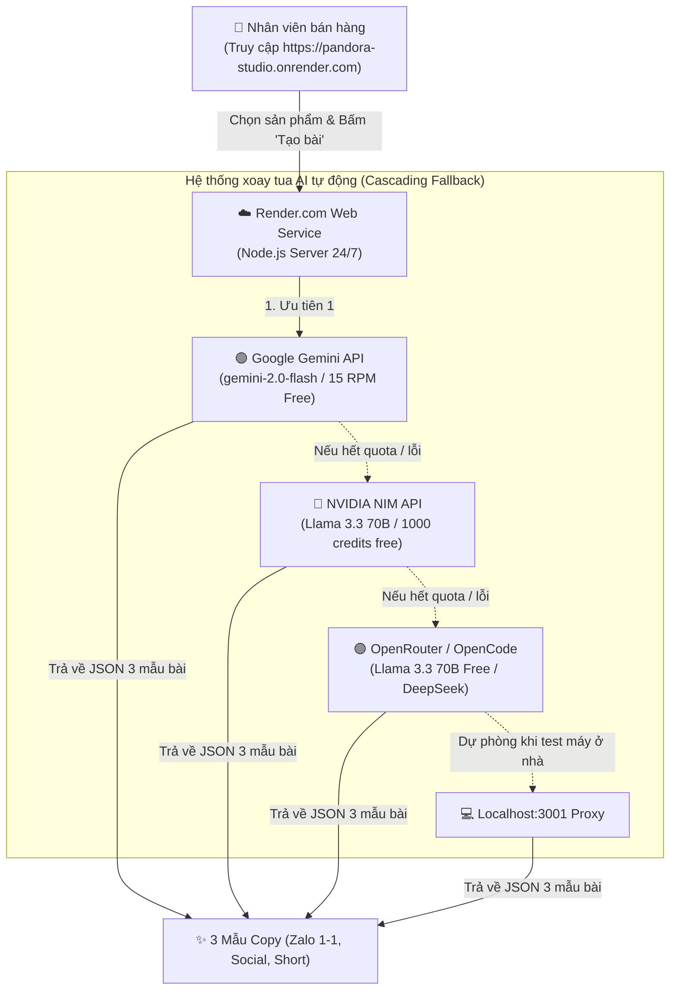

# 🚀 KẾ HOẠCH TRIỂN KHAI CLOUD RENDER VỚI 3 NGUỒN AI MỞ (100% MIỄN PHÍ - 24/7)

Kế hoạch này hướng dẫn chi tiết cách triển khai **Pandora Sales Content Studio** lên máy chủ đám mây **Render.com** kết hợp cơ chế xoay tua thông minh **3 nhà cung cấp API mở & miễn phí**: **Google Gemini**, **NVIDIA NIM**, và **OpenRouter (OpenCode)**.

> [!NOTE]
> Khi lên Cloud, hệ thống hoàn toàn độc lập với máy tính của bạn. Dù bạn tắt máy, đi ngủ hay ngắt mạng, nhân viên bán hàng vẫn truy cập web trên điện thoại/laptop và tạo bài viết bình thường 24/7!

---

## 🧭 1. KIẾN TRÚC HOẠT ĐỘNG CLOUD & CƠ CHẾ DỰ PHÒNG 3 LỚP (CASCADING FALLBACK)



---

## 🔑 2. TỔNG HỢP 3 NGUỒN API MỞ ĐỂ ĐIỀN VÀO `.env`

Dưới đây là link lấy API Key miễn phí cho 3 nguồn mở:

| STT | Nhà cung cấp | Model khuyến nghị | Link lấy Key miễn phí | Đặc điểm / Quota |
| :--- | :--- | :--- | :--- | :--- |
| **1** | **Google Gemini** | `gemini-2.0-flash` | [aistudio.google.com/app/apikey](https://aistudio.google.com/app/apikey) | 15 yêu cầu/phút (RPM) Free vĩnh viễn, tốc độ cực nhanh (< 1.5s), Tiếng Việt hoàn hảo. |
| **2** | **NVIDIA NIM** | `meta/llama-3.3-70b-instruct` | [build.nvidia.com](https://build.nvidia.com/meta/llama-3-3-70b-instruct) | Tặng sẵn 1.000 credits miễn phí, chạy model Llama 3.3 70B thông minh hàng đầu thế giới. |
| **3** | **OpenRouter / OpenCode** | `meta-llama/llama-3.3-70b-instruct:free` | [openrouter.ai/keys](https://openrouter.ai/keys) | Hỗ trợ hàng loạt model `:free`, mở mã nguồn không giới hạn. |

### Cấu hình trong file `.env` máy bạn (đã được tạo sẵn trong dự án):
```env
# 1. Google Gemini API
GEMINI_API_KEY=AIzaSy...
GEMINI_MODEL=gemini-2.0-flash
GEMINI_BASE_URL=https://generativelanguage.googleapis.com/v1beta/openai

# 2. OpenRouter / OpenCode API
OPENROUTER_API_KEY=sk-or-v1-...
OPENROUTER_MODEL=meta-llama/llama-3.3-70b-instruct:free
OPENROUTER_BASE_URL=https://openrouter.ai/api/v1

# 3. NVIDIA NIM API
NVIDIA_NIM_API_KEY=nvapi-...
NVIDIA_NIM_MODEL=meta/llama-3.3-70b-instruct
NVIDIA_NIM_BASE_URL=https://integrate.api.nvidia.com/v1

# Local Proxy dự phòng
LOCAL_LLM_URL=http://localhost:3001/v1
LOCAL_LLM_API_KEY=freellmapi-db0b02100a84e67c074f72c495cbeb071573a91846c97f46
LOCAL_LLM_MODEL=auto
```

---

## 📋 3. MASTER PLAN TRIỂN KHAI 4 BƯỚC LÊN RENDER (100% FREE)

### BƯỚC 1: Đẩy mã nguồn & Cache 941 sản phẩm lên GitHub
1. Mở trang [https://github.com](https://github.com), đăng nhập và tạo 1 repository mới (ví dụ: `pandora-content-studio`, chọn chế độ **Private**).
2. Chạy các lệnh Git tại thư mục dự án trên máy tính:
   ```powershell
   git init
   git add .
   git commit -m "feat: complete pandora studio with multi-provider cloud AI (Gemini, NVIDIA, OpenRouter)"
   git branch -M main
   git remote add origin https://github.com/<tai_khoan_github>/pandora-content-studio.git
   git push -u origin main
   ```
   *(Toàn bộ 941 file sản phẩm trong `cache/products/` sẽ được đẩy lên Git, máy chủ Render khi khởi động sẽ tải được ngay lập tức)*.

---

### BƯỚC 2: Tạo Web Service Miễn Phí trên Render.com
1. Mở [https://render.com](https://render.com) và đăng nhập bằng tài khoản GitHub.
2. Tại trang chủ Dashboard, bấm **New +** $\rightarrow$ chọn **Web Service**.
3. Chọn tùy chọn **Build and deploy from a Git repository**, chọn repo `pandora-content-studio`.
4. Điền các trường cấu hình:
   - **Name**: `pandora-studio` *(hoặc tên bạn thích)*
   - **Region**: `Singapore` *(tối ưu độ trễ cho người dùng tại Việt Nam)*
   - **Branch**: `main`
   - **Runtime**: `Node`
   - **Build Command**: `npm install`
   - **Start Command**: `npm start`
   - **Instance Type**: Chọn **Free ($0/month)**.

---

### BƯỚC 3: Điền Environment Variables trên Render
Tại phần **Environment Variables** (Biến môi trường) của Render, bạn thêm các cặp Key - Value sau:

| Tên biến (Key) | Giá trị mẫu (Value) | Ghi chú |
| :--- | :--- | :--- |
| `PORT` | `3000` | Port lắng nghe |
| `NODE_ENV` | `production` | Chạy chế độ production |
| `GEMINI_API_KEY` | *(Key của bạn từ Google AI Studio)* | Bắt đầu bằng `AIzaSy...` |
| `GEMINI_MODEL` | `gemini-2.0-flash` | Model chính |
| `GEMINI_BASE_URL` | `https://generativelanguage.googleapis.com/v1beta/openai` | Chuẩn OpenAI tương thích |
| `NVIDIA_NIM_API_KEY`| *(Key của bạn từ NVIDIA)* | Bắt đầu bằng `nvapi-...` |
| `NVIDIA_NIM_MODEL` | `meta/llama-3.3-70b-instruct` | Dự phòng Lớp 1 |
| `NVIDIA_NIM_BASE_URL`| `https://integrate.api.nvidia.com/v1` | Chuẩn OpenAI tương thích |
| `OPENROUTER_API_KEY`| *(Key của bạn từ OpenRouter)* | Bắt đầu bằng `sk-or-...` |
| `OPENROUTER_MODEL` | `meta-llama/llama-3.3-70b-instruct:free` | Dự phòng Lớp 2 |
| `OPENROUTER_BASE_URL`| `https://openrouter.ai/api/v1` | Chuẩn OpenAI tương thích |

> [!TIP]
> Bạn không nhất thiết phải có đủ cả 3 key ngay. Hệ thống được lập trình **tự động nhận diện**: nếu bạn chỉ nhập Gemini Key thì dùng Gemini; nếu nhập cả 3 thì hệ thống tự động ưu tiên Gemini, nếu Gemini quá tải/hết quota sẽ tự động chuyển sang NVIDIA NIM, nếu NVIDIA hết credit sẽ chuyển sang OpenRouter mà không bị gián đoạn!

5. Bấm **Create Web Service** và chờ Render build trong khoảng 1-2 phút.

---

### BƯỚC 4: Bàn giao link cho nhân viên sử dụng
Render sẽ cấp một đường link HTTPS miễn phí:
👉 **`https://pandora-studio.onrender.com/writer.html`**

- Bạn có thể tắt máy tính hoàn toàn.
- Bất cứ nhân viên nào mở link trên điện thoại hoặc máy tính ở bất kỳ đâu đều có thể:
  1. Xem danh mục 941 sản phẩm Pandora (tìm kiếm nhanh, lọc theo 6 danh mục & các kiểu vòng).
  2. Bấm **Tạo bài viết** để sinh ngay 3 mẫu nội dung Zalo, Social, Ngắn.
  3. Bấm **Copy** để dán gửi cho khách hàng.
